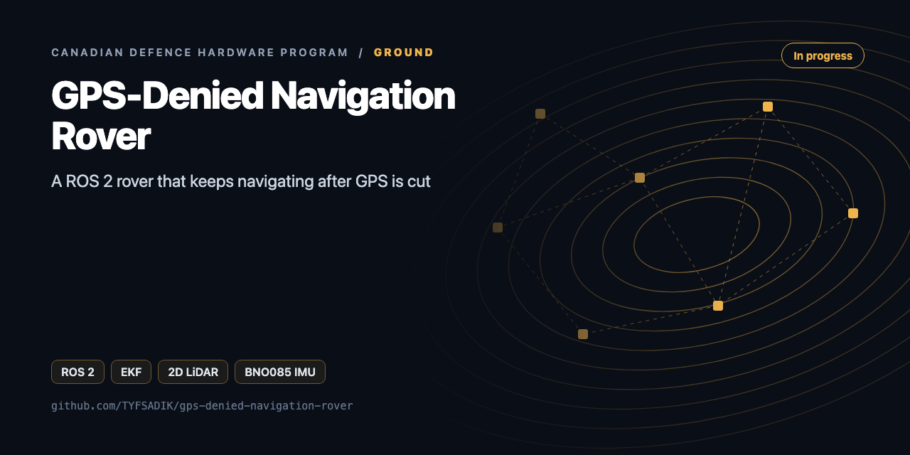
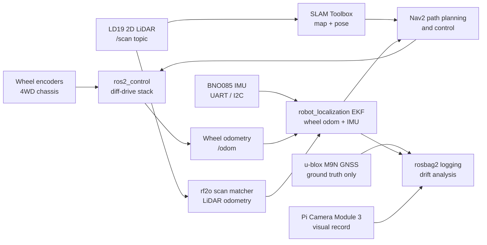

<div align="center">



# GPS-Denied Navigation Rover

**ROS 2 rover that keeps navigating after GNSS is cut: wheel odometry, BNO085 IMU, and 2D LiDAR fused with an Extended Kalman Filter, drift vs u-blox truth.**

[](https://github.com/TYFSADIK/gps-denied-navigation-rover/actions/workflows/tests.yml)   [](LICENSE) [](https://github.com/TYFSADIK/defence-hardware-program)

[Build guide](docs/project-page.md) · [How it works](#how-it-works) · [Quick start](#quick-start) · [Program hub](https://github.com/TYFSADIK/defence-hardware-program)

</div>

## Overview

This build is a wheeled skid-steer rover (a 4WD metal chassis) that keeps an honest estimate of where it is **after its satellite navigation is taken away**. Wheel encoders, a BNO085 IMU, and a 2D LiDAR feed an Extended Kalman Filter running on a Raspberry Pi 5 under ROS 2. The u-blox M9N GNSS module rides along only as a reference track: I drive a known loop with GNSS on, then switch it off and measure how fast the estimated position drifts away from reality, expressed as error versus distance travelled.

Why this matters in Canada: **DRDC is testing GPS-denied navigation, convoying, and cold-weather performance on exercises like Operation NANOOK**, because GNSS jamming and denial are now baseline assumptions in any real operating area, and because the high Arctic adds weak satellite geometry on top. The Army's MINERVA challenges and the Defence Drone Initiative (launched July 23, 2026) both name ground robots that must keep working in exactly these conditions.

The build pattern is not mine. Published research (including work on arXiv) shows terrain-referenced and dead-reckoning localization for ground vehicles that fuses wheel odometry and IMU in GNSS-denied environments, with scan matching to arrest drift. This rover reproduces that pattern at hobby scale, on hardware already on my bench, with the drift numbers measured and published rather than assumed.

## How it works



*Sensors feed the EKF estimate that drives Nav2; GNSS logs alongside as ground truth and never enters the control loop.*

## Quick start

```bash
# Host tests (no ROS needed; brew install eigen)
c++ -std=c++17 -O2 -Iros2_ws/src/gdn_rover/include -I$(brew --prefix eigen)/include/eigen3     ros2_ws/src/gdn_rover/test/test_core.cpp -o /tmp/gdn_test && /tmp/gdn_test
python -m unittest -v

# On the rover (ROS 2 Jazzy)
cd ros2_ws && colcon build --symlink-install && source install/setup.bash
ros2 launch gdn_rover rover.launch.py run:=4
```

## What's in this repo

| Path | Language | Purpose |
|---|---|---|
| `ros2_ws/src/gdn_rover/include/gdn_rover/skid_steer.hpp` | C++17 | Skid-steer odometry: **effective track width**, midpoint integration, encoder wraparound, slip-aware twist covariance (yaw sigma grows with turn rate) |
| `.../ekf.hpp` | C++17 / Eigen | Independent planar EKF (x, y, yaw, v, ω) with Mahalanobis gating and Joseph update, used to cross-check robot_localization |
| `.../src/wheel_odom_node.cpp` | C++ / rclcpp | `wheel/ticks` → `wheel/odom` (twist + covariance) |
| `.../config/ekf_run3_*.yaml`, `ekf_run4_*.yaml` | YAML | robot_localization configs for Run 3 (encoders + IMU) and Run 4 (+ LiDAR witness). GNSS is recorded but never fused |
| `.../launch/rover.launch.py` | Python | LD19 + rf2o + EKF + wheel odometry, selected with `run:=3` or `run:=4` |
| `gdn_eval/trajectory.py` | Python | ATE/RPE with **Umeyama alignment on the pre-cut segment only**, error at +30/60/120 s, drift % of distance |
| `gdn_eval/export.py` | Python | ROS 2 bag → CSV without ROS (`rosbags`) |

## What you need

| Category | Item | Notes |
|----|----|----|
| Hardware | 4WD metal chassis + encoders | Skid-steer platform with quadrature wheel encoders; metal survives repeated outdoor loop runs |
| Hardware | Raspberry Pi 5 | Runs Ubuntu 24.04 and the full ROS 2 Jazzy stack, including the EKF |
| Hardware | BNO085 IMU, LD19 LiDAR | Orientation and 2D scan matching; verify the IMU mode-strap pins against the datasheet before trusting the driver |
| Hardware | u-blox M9N GNSS | Ground truth only: it measures drift, it never aids the filter |
| Hardware | BTS7960 drivers, split power rail, e-stop | Fused logic branch separate from motor rail; e-stop cuts motors only |
| Software | ROS 2 Jazzy, robot_localization, rf2o | Diff-drive control, the EKF, and laser scan matching |
| Software | rosbag2, Python analysis | Every run is recorded; drift is computed offline as error versus distance travelled |
| Skills | ROS 2, state estimation basics, Linux | URDF/TF debugging, covariance reasoning, covariance tuning, rosbag workflows |
| Accounts | None | No accounts or licenses required; the whole stack is open source |

## Status

- **Done**: chassis assembled with encoders wired, BTS7960 drive train and power rail benched (stall-tested, no brownouts after the rail split), e-stop installed and tested, Ubuntu 24.04 + ROS 2 Jazzy on the Pi 5, URDF measured and TF-verified, diff-drive `ros2_control` stack driving the rover, BNO085 and LD19 publishing at rate, Runs 1-2 (bench spin, straight-line calibration) complete.
- **In progress**: EKF tuning in `robot_localization` (covariance work), rf2o integration, first GNSS-cut loop runs with rosbag logging, drift analysis scripts.
- **Next**: LiDAR aiding comparison runs (Runs 3-5), publish the dataset and drift plots, winter cold-weather repeat (Run 6); second rover becomes the convoy follower.

| Metric | Target | Measured to date | Current status |
|----|----|----|----|
| Loop-closure error, EKF only (Run 3) | Under 2% of distance travelled | Not yet measured | In progress, tuning passes underway, not yet measured against truth |
| Loop-closure error, EKF + LiDAR aiding (Run 4) | Measurably better than Run 3 on the same loop | Not yet measured | In progress, rf2o integration benched, comparison runs not yet done |
| Drift growth after GNSS cut (Run 5) | Published error-versus-distance curve, both configurations | Not yet measured | In progress, logging pipeline ready, first cut runs planned |
| Heading error growth, GNSS denied | Quantified per 100 m travelled | Not yet measured | In progress |
| IMU bias stability across a run | No visible yaw drift in a static 10-minute log | Not yet measured | In progress, static logs collected, analysis pending |
| Cold-weather drift delta (Run 6) | Same protocol repeated at winter temperatures | No data, waiting on winter | Planned, waiting on weather |

## Roadmap

- [ ] Run 2: calibrate `effective_track_m` with in-place turns (`calibrate_effective_track`) on grass, gravel, and snow, and keep one value per surface
- [ ] Publish encoder ticks from the motor controller as `std_msgs/Int32MultiArray` on `wheel/ticks`
- [ ] Run 5 GNSS cut: bag everything, then `export` → `trajectory --cut <t>`
- [ ] Add scan-match health (rf2o fails on featureless snow) and inflate LiDAR covariance when few points are returned
- [ ] Move to 3D: KISS-ICP or FAST-LIO on a 3D LiDAR (see `gps-denied-cargo-ugv`)

## Related builds

- [Canadian Defence Hardware Program](https://github.com/TYFSADIK/defence-hardware-program), the hub: every build, full BOMs, and the stated Canadian requirements each one answers.
- [Convoy-Following Robots on a Degraded Mesh](https://github.com/TYFSADIK/rover-drive-stack), the second rover follows a lead over a lossy LoRa/Wi-Fi mesh; it depends on this page's localization stack.
- [Ground Seismic & Acoustic Perimeter Mesh](https://github.com/TYFSADIK/ground-seismic-perimeter-mesh), the mesh detects, and this rover is the human-tasked verify asset that drives out to look.
- [Multi-Domain Common Operating Picture](https://github.com/TYFSADIK/multi-domain-common-operating-picture), where this rover's signed tracks eventually publish alongside the sky, water, and ground nodes.

## Learn more

The full build guide, with step-by-step instructions, wiring, troubleshooting and lessons learned, is in [docs/project-page.md](docs/project-page.md). It is also published at [tyfsadik.org](https://tyfsadik.org/work/defence/gps-denied-navigation-rover.html).

## License

[MIT](LICENSE). Built by [Taki Sadik](https://tyfsadik.org) as part of the self-funded [Canadian Defence Hardware Program](https://github.com/TYFSADIK/defence-hardware-program).
