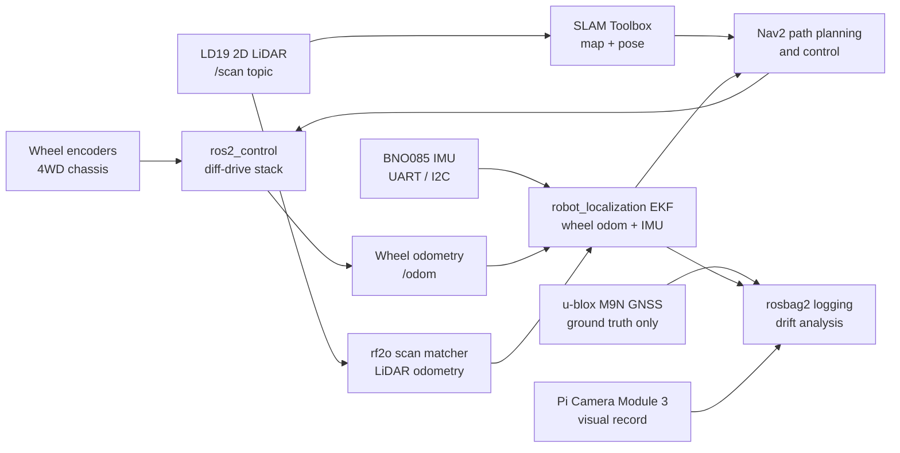
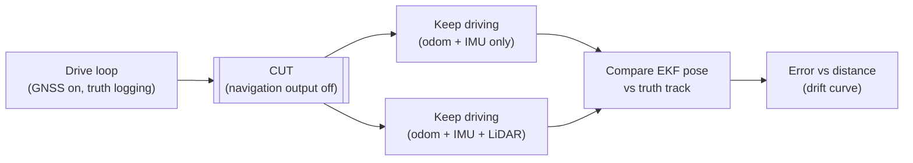

# GPS-Denied Navigation Rover

Written by [Taki Sadik](https://tyfsadik.org/about.html) · Last updated 2026-10-22 · Status: Building · 33 min read

A ROS 2 rover that keeps navigating after GNSS is cut: wheel odometry, a BNO085 IMU, and 2D LiDAR fused with an Extended Kalman Filter, with position drift measured against a u-blox reference track (meter-class GNSS, not survey grade).

## Overview

This build is a wheeled skid-steer rover (a 4WD metal chassis) that keeps an honest estimate of where it is **after its satellite navigation is taken away**. Wheel encoders, a BNO085 IMU, and a 2D LiDAR feed an Extended Kalman Filter running on a Raspberry Pi 5 under ROS 2. The u-blox M9N GNSS module rides along only as a reference track: I drive a known loop with GNSS on, then switch it off and measure how fast the estimated position drifts away from reality, expressed as error versus distance travelled.

Why this matters in Canada: **DRDC is testing GPS-denied navigation, convoying, and cold-weather performance on exercises like Operation NANOOK**, because GNSS jamming and denial are now baseline assumptions in any real operating area, and because the high Arctic adds weak satellite geometry on top. The Army's MINERVA challenges and the Defence Drone Initiative (launched July 23, 2026) both name ground robots that must keep working in exactly these conditions.

The build pattern is not mine. Published research (including work on arXiv) shows terrain-referenced and dead-reckoning localization for ground vehicles that fuses wheel odometry and IMU in GNSS-denied environments, with scan matching to arrest drift. This rover reproduces that pattern at hobby scale, on hardware already on my bench, with the drift numbers measured and published rather than assumed.

## Bill of Materials

Everything below is purchased and on the bench. The u-blox M9N GNSS module used for ground truth is shared from the program's Phase 0 kit. Software (Ubuntu 24.04, ROS 2 Jazzy) is free.

| Part | Role | Details | Est. US\$ |
|----|----|----|----|
| Chassis | Wheeled skid-steer base | 2 metal 4WD chassis with wheel encoders | 80-150 each |
| Compute | ROS 2 navigation stack | Pi 5 8 GB per rover, active cooler | ~145 each |
| Motor driver | Skid-steer drive | 2x BTS7960 full-bridge modules, one per side (each module is two BTS7960 half-bridges) | 20-60 |
| LiDAR | External drift witness | 2D LiDAR (LD19 / RPLIDAR A1 class), one rover first | 70-150 |
| IMU | Heading and attitude | BNO085 breakout, 9-axis on-chip fusion | 25-40 |
| Camera | Visual verification | Pi Camera Module 3 | 25-50 |
| Power | Split-rail power and safety | Li-ion pack with BMS, DC-DC 5 V/5 A, physical e-stop switch | 60-100 |

## Wiring & Connections

The full interconnect map. Two rules govern everything: motor power and logic power never share a rail, and every signal pair gets a common ground reference back to the Pi.

| From | To | Cable or interface | Notes |
|----|----|----|----|
| Li-ion pack | BMS, then main fuse (10 A) | 18 AWG silicone wire, XT60 | Fuse within 10 cm of the pack; BMS handles cell protection and balancing |
| Fused pack output | BTS7960 B+ / B- (motor power) | 18 AWG, through the e-stop switch | Latching mushroom e-stop in series; cuts motor power only, never the Pi |
| Fused pack output | DC-DC buck to 5 V / 5 A | 18 AWG in, USB-C breakout out | Separate branch from the motor rail, fused at 3 A; powers Pi 5 and sensors |
| Pi 5 GPIO 12, 13 (PWM0) / 18, 19 (PWM1) | BTS7960 RPWM / LPWM per side | 22 AWG jumper, 20 cm max | Hardware PWM channels; BTS7960 R_EN / L_EN tied high through a GPIO kill line |
| BTS7960 B- | Pi 5 GND | 22 AWG | Common ground is mandatory, without it PWM levels float and the motors twitch |
| Wheel encoders (A/B quadrature, x4) | Pi 5 GPIO inputs | Twisted pair per encoder | Hall encoders, 3.3 V pull-ups; counted by pigpio hardware-timed callbacks |
| BNO085 breakout | Pi 5 UART0 (GPIO 14 TX / 15 RX, /dev/serial0) | 4-wire: VIN 3.3 V, GND, TX, RX | PS1 high and PS0 low select UART-SHTP (3 Mbit/s), not the UART-RVC heading-only mode; udev symlink /dev/imu |
| LD19 LiDAR | Pi 5 USB-A (via its UART-USB adapter board) | USB cable from the adapter board | 230400 baud serial; udev symlink /dev/lidar; powered from the 5 V rail |
| Pi Camera Module 3 | Pi 5 CSI port | 15-to-22-pin FPC ribbon | Kept short and away from the motor wiring to avoid noise on the ribbon |
| u-blox M9N (ground truth) | Pi 5 USB-A | USB cable | Logging only, never wired into the estimator; antenna on a ground plate away from the LiDAR |

## Architecture

Figure 1: sensors feed the EKF estimate that drives Nav2; GNSS logs alongside as ground truth and never enters the control loop.

The key discipline: GNSS is **not an input to the estimator**. It is logged in parallel so that when I switch it off, the comparison between the EKF's belief and the last known true track gives a clean, honest drift measurement. The rover navigates the whole time on what it can sense on board.

## What the EKF Fuses, and What It Refuses to Know

The extended Kalman filter in `robot_localization` is not a blender; it is a referee. Each sensor reports a pose fragment plus a **covariance** that says how much the filter should trust it. The wheel encoders report translation and rotation, but they are **slip-blind**: a spinning wheel in mud reports motion the chassis never made, and the encoders cannot tell. The BNO085 reports heading and attitude from its on-chip SH-2 fusion (accelerometer, gyro, and magnetometer fused on an ARM core inside the sensor), but it measures no translation at all. The LiDAR, through rf2o scan matching, is the only **external witness**: it compares consecutive scans against the world and reports how the world actually moved, which arrests the drift the first two accumulate.

The discipline of the experiment is which sensors are *allowed* in each run. Run 3 feeds the EKF encoders and IMU only, so the drift curve measures proprioception alone; Run 4 adds the LiDAR witness, so the difference between the curves is the LiDAR's contribution. GNSS is logged beside all of it and subscribed to by nothing, which is what makes the Run 5 cut honest: the truth log is independent of the belief being measured.

## How I Built It

WHAT: assembled the metal 4WD chassis, mounted the four gear motors with their Hall encoders, and wired each side's two motors in parallel to one BTS7960 full-bridge module (two modules total, one per side), giving classic skid-steer (left channel, right channel). WHY: skid-steer needs no steering servo and turns in place, which is exactly what a survey-and-verify rover wants, at the cost of wheel scrub, which is precisely the odometry problem this build exists to measure.

Each module is a full bridge built from two BTS7960 half-bridges: each side gets an RPWM/LPWM pair (forward/reverse PWM) plus R_EN/L_EN enables. I verified motor polarity and encoder direction per channel with a small pigpio test script before anything touched ROS, a mislabelled encoder pair silently corrupts odometry and is miserable to debug later.

**Motor_test.py, spin each side slowly, print encoder counts**

    import pigpio, time
    pi = pigpio.pi()
    # BTS7960: (RPWM, LPWM) per side on hardware-PWM-capable GPIOs
    LEFT, RIGHT = (12, 13), (18, 19)
    for rpwm, lpwm in (LEFT, RIGHT):
        pi.set_PWM_frequency(rpwm, 20000)   # 20 kHz: above audible
        pi.set_PWM_frequency(lpwm, 20000)
        pi.set_PWM_dutycycle(rpwm, 60)      # ~24% duty, forward creep
        time.sleep(2)
        pi.set_PWM_dutycycle(rpwm, 0)

What can go wrong: with the common ground between the BTS7960 and the Pi missing or loose, the PWM reference floats and the motors twitch randomly. I verified with a multimeter continuity check from driver B- to Pi GND before first power-up, and confirmed each side spins forward for a positive command.

WHAT: the Li-ion pack feeds two fused branches, one through the latching e-stop to the BTS7960 motor input, one through a DC-DC buck producing a clean 5 V/5 A rail for the Pi 5, LiDAR, IMU, and camera. WHY: a stalled 4WD drivetrain pulls many amps and drags an unprotected shared rail down with it; the instant the Pi browns out, your estimator dies and the log with it. Separating the rails is the single most important reliability decision on the build.

The e-stop is a physical, latching mushroom switch wired in series with the motor branch only. Press it and the wheels are dead while the Pi keeps logging and can still be SSH'd into, which is what you want for post-incident forensics. Every test run starts with an e-stop check and a clear test area.

**Rail check, under-voltage flags before and during runs**

    vcgencmd get_throttled        # bit 0 set = under-voltage detected now
    dmesg | grep -i voltage       # kernel log of brownout events
    vcgencmd pmic_read_adc         # Pi 5: reads the actual 5 V input rail (measure_volts core reads the SoC core rail, not the supply)

How I verified: brief 2-3 second stalls of all four motors against a blocked wheel on a current-limited bench supply while watching `vcgencmd get_throttled` in a loop, the throttled flags stayed at `0x0`, meaning the logic rail never dipped. Before the rail split, the same test tripped under-voltage within seconds. Stall testing is done brief and current-limited only: stalled motors get hot fast and a stalled drivetrain across a battery is a fire risk, never run this against the Li-ion pack directly.

WHAT: Ubuntu 24.04 Server (64-bit) flashed to a high-endurance microSD, then ROS 2 Jazzy from the official apt repository. WHY: Jazzy is the current LTS ROS 2 release and pairs natively with Ubuntu 24.04 (noble); staying on the supported pairing means every package I need, `robot_localization`, `slam_toolbox`, Nav2, installs from binary debs instead of source builds on an ARM board.

I install `ros-jazzy-ros-base` (headless, no desktop GUI) because the rover runs without a monitor; RViz runs on the laptop over the network with a shared `ROS_DOMAIN_ID`.

**Install, ros 2 jazzy on ubuntu 24.04 (noble)**

    sudo apt update && sudo apt install -y curl gnupg lsb-release
    sudo curl -sSL https://raw.githubusercontent.com/ros/rosdistro/master/ros.key \
      -o /usr/share/keyrings/ros-archive-keyring.gpg
    echo "deb [arch=$(dpkg --print-architecture) signed-by=/usr/share/keyrings/ros-archive-keyring.gpg] \
      http://packages.ros.org/ros2/ubuntu noble main" \
      | sudo tee /etc/apt/sources.list.d/ros2.list
    sudo apt update
    sudo apt install -y ros-jazzy-ros-base python3-colcon-common-extensions python3-rosdep
    sudo rosdep init && rosdep update
    echo "source /opt/ros/jazzy/setup.bash" >> ~/.bashrc

How I verified: `ros2 run demo_nodes_cpp talker` on the rover and the matching listener on the laptop over Wi-Fi, if messages flow, the install, the network, and the domain configuration are all good before any robot code exists.

WHAT: wrote the `robot_description` URDF for the chassis, `base_link` at the geometric center, four wheel links at measured offsets, `imu_link` at the BNO085's physical location, `laser_link` at the LiDAR puck's rotation center. WHY: the EKF, the scan matcher, and SLAM all fuse data through TF transforms; if `laser_link` is 5 cm off its real position, every fused estimate inherits that bias and it shows up as a mystery drift that no amount of covariance tuning fixes.

Every offset in this file was measured on the physical robot with calipers, not copied from the chassis listing. The listing lies; the calipers don't.

**Urdf/rover.urdf (core frames, offsets measured on the bench)**

    <robot name="gps_denied_rover">
      <link name="base_link"/>
      <link name="laser_link"/>
      <joint name="laser_joint" type="fixed">
        <parent link="base_link"/>
        <child link="laser_link"/>
        <origin xyz="0.10 0.0 0.18" rpy="0 0 0"/>
      </joint>
      <link name="imu_link"/>
      <joint name="imu_joint" type="fixed">
        <parent link="base_link"/>
        <child link="imu_link"/>
        <origin xyz="0.02 0.0 0.09" rpy="0 0 0"/>
      </joint>
      <!-- left_wheel_joint / right_wheel_joint: continuous, at measured
           wheel_separation/2 = +/-0.16 m, radius 0.065 m -->
    </robot>

How I verified: `ros2 run tf2_tools view_frames` generates a PDF of the live TF tree, I checked every frame appears under `base_link` with the measured offsets, and in RViz the laser scan overlays cleanly on walls when the rover rotates in place (a wrong laser offset makes the scan smear in an arc).

WHAT: brought up the `ros2_control` framework with `diff_drive_controller` commanding the motors through a custom hardware interface that exports PWM duty to the BTS7960 through the Pi 5's hardware PWM channels (GPIO 12/13 and 18/19 via /dev/pwmchip; pigpio does not support the Pi 5's RP1), and reads the four encoder channels back as wheel joint states via gpiod. WHY: `diff_drive_controller` gives me a calibrated `/odom` topic and a `/cmd_vel` interface for free, the same interface Nav2 expects, as long as `wheel_separation` and `wheel_radius` are honest.

Two of the four wheels per side share one joint in the controller config (left pair as one virtual wheel, right pair as one); both encoders on a side are averaged in the hardware interface, which dampens single-encoder glitches.

**Config/controllers.yaml, diff_drive_controller parameters**

    controller_manager:
      ros__parameters:
        update_rate: 50
        joint_state_broadcaster:
          type: joint_state_broadcaster/JointStateBroadcaster
        diff_drive_controller:
          type: diff_drive_controller/DiffDriveController

    diff_drive_controller:
      ros__parameters:
        left_wheel_names: ["left_wheel_joint"]
        right_wheel_names: ["right_wheel_joint"]
        wheel_separation: 0.32      # measured, then calibrated (see Run 2)
        wheel_radius: 0.065         # measured with calipers
        publish_rate: 50.0
        # NOTE: encoder ticks (1200/rev after x4 quadrature decoding) are a parameter of
        # the custom hardware interface that converts ticks to radians, NOT of
        # diff_drive_controller, which only takes wheel_radius and wheel_separation.
        odom_frame_id: odom
        base_frame_id: base_link
        enable_odom_tf: false       # the EKF owns odom->base_link

How I verified: `ros2 control list_controllers` shows both controllers active, then `ros2 topic pub /cmd_vel geometry_msgs/Twist ...` at 0.2 m/s with the wheels off the ground while watching `ros2 topic echo /odom`, reported velocity matched the command and stopped cleanly at zero. `enable_odom_tf: false` matters: two publishers fighting over `odom->base_link` (controller and EKF) causes TF frame fighting and a robot that teleports in RViz.

WHAT: wired the BNO085 breakout over UART (Pi 5 `/dev/serial0`, GPIO 14/15) with I2C as fallback, and publish `sensor_msgs/Imu` from a small node I wrote wrapping the Adafruit CircuitPython BNO08x library over the SHTP protocol. WHY: the BNO085 does sensor fusion on-chip, it outputs rotation-vector orientation already filtered against gyro drift, which at this price point is far better than anything I would integrate from raw gyro rates on the Pi.

The BNO085's mode is selected by strapping pins: PS1 high with PS0 low selects UART-SHTP (3 Mbit/s); PS1 high alone does not select anything by itself, and PS1 low with PS0 high gives the simplified UART-RVC mode, a 100 Hz heading-only stream, not full SHTP. A udev rule gives the port a stable name so the node never breaks when USB devices enumerate in a different order.

**/etc/udev/rules.d/99-rover.rules + node bring-up**

    # stable device names regardless of enumeration order
    KERNEL=="ttyAMA10", SYMLINK+="imu"
    SUBSYSTEM=="tty", ATTRS{idVendor}=="10c4", SYMLINK+="lidar"

    pip3 install --user adafruit-circuitpython-bno08x
    ros2 run rover_bringup bno085_uart_node --ros-args \
      -p port:=/dev/imu -p frame_id:=imu_link
    ros2 topic hz /imu/data     # expect a steady 100 Hz

What can go wrong: the first bring-up published garbage because the breakout shipped with PS1 floating and was actually in I2C mode, the UART port stayed silent and my node timed out. Fixed by soldering the PS1 jumper, then verified by rotating the rover 90 degrees by hand against a square and confirming the published yaw moved by 1.57 rad, not by "about" 90 degrees.

WHAT: the LD19 2D LiDAR (360-degree triangulation scanner, 12 m class range on high-reflectivity targets, less on dark ones) connects through its UART-to-USB adapter board and publishes `sensor_msgs/LaserScan` on `/scan` via the vendor's ROS 2 driver. WHY: LiDAR is the only sensor on the rover that observes the world rather than the wheels, wheel odometry and IMU are both proprioceptive and both drift, while scan matching against static walls gives an external reference that arrests that drift.

One rover gets the LiDAR first; the second rover runs encoder+IMU-only until the aiding comparison runs are done, which conveniently isolates the LiDAR's contribution as an experimental variable.

**Driver, ldlidar_stl_ros2 build and launch**

    cd ~/ros2_ws/src
    git clone https://github.com/ldrobotSensorTeam/ldlidar_stl_ros2.git
    cd ~/ros2_ws
    rosdep install --from-paths src -y --ignore-src
    colcon build --packages-select ldlidar_stl_ros2
    source install/setup.bash
    ros2 launch ldlidar_stl_ros2 ld19.launch.py   # port_name:=/dev/lidar
    ros2 topic hz /scan                           # expect ~10 Hz

How I verified: placed the rover in a corner of the room, echoed `/scan` ranges at the four cardinal angles, and compared against a tape measure, readings agreed within the sensor's stated tolerance. A scan that looks plausible but is rotated 180 degrees is the classic silent failure here, which is why step 04's frame verification matters.

WHAT: the `robot_localization` package runs an Extended Kalman Filter (`ekf_node`) fusing wheel odometry (x and yaw velocities) with the BNO085's fused orientation and angular velocity, publishing the `odom->base_link` transform on `/odometry/filtered`. WHY: the encoders are good at short-range translation but blind to slip; the IMU is excellent at heading but can't measure translation at all. The EKF is where each sensor covers the other's blind spot, with honest covariances so the filter knows how much to trust each input.

The tuning principle I follow: trust the IMU for heading (its yaw is drift-corrected on-chip), trust the encoders for short-range translation, and let the covariance grow when inputs disagree instead of forcing consistency. Over-tight covariances are how you get a filter that is confidently wrong.

**Config/ekf.yaml, robot_localization ekf (2d mode)**

    ekf_filter_node:
      ros__parameters:
        frequency: 30.0
        two_d_mode: true
        publish_tf: true
        odom_frame: odom
        base_link_frame: base_link
        world_frame: odom
        odom0: /odom
        odom0_config: [false, false, false,
                       false, false, false,
                       true,  false, false,
                       false, false, true,
                       false, false, false]
        odom0_differential: false
        odom1: /odom_rf2o
        odom1_config: [false, false, false,
                       false, false, false,
                       true,  false, false,
                       false, false, true,
                       false, false, false]
        odom1_differential: false
        imu0: /imu/data
        imu0_config: [false, false, false,
                      false, false, true,   # fused yaw orientation
                      false, false, false,
                      false, false, true,   # yaw rate
                      false, false, false]
        # false: imu0_config fuses no linear acceleration, so there is nothing to de-gravitize
        imu0_remove_gravitational_acceleration: false
        # process_noise_covariance is a 15x15 matrix (x,y,z,roll,pitch,yaw,v...,a...); diagonal below, starting point, tuned per Run 3
        process_noise_covariance: [0.05, 0.0, 0.0, 0.0, 0.0, 0.0, 0.0, 0.0, 0.0, 0.0, 0.0, 0.0, 0.0, 0.0, 0.0,
                                   0.0, 0.05, 0.0, 0.0, 0.0, 0.0, 0.0, 0.0, 0.0, 0.0, 0.0, 0.0, 0.0, 0.0, 0.0,
                                   0.0, 0.0, 0.06, 0.0, 0.0, 0.0, 0.0, 0.0, 0.0, 0.0, 0.0, 0.0, 0.0, 0.0, 0.0,
                                   0.0, 0.0, 0.0, 0.03, 0.0, 0.0, 0.0, 0.0, 0.0, 0.0, 0.0, 0.0, 0.0, 0.0, 0.0,
                                   0.0, 0.0, 0.0, 0.0, 0.03, 0.0, 0.0, 0.0, 0.0, 0.0, 0.0, 0.0, 0.0, 0.0, 0.0,
                                   0.0, 0.0, 0.0, 0.0, 0.0, 0.06, 0.0, 0.0, 0.0, 0.0, 0.0, 0.0, 0.0, 0.0, 0.0,
                                   0.0, 0.0, 0.0, 0.0, 0.0, 0.0, 0.025, 0.0, 0.0, 0.0, 0.0, 0.0, 0.0, 0.0, 0.0,
                                   0.0, 0.0, 0.0, 0.0, 0.0, 0.0, 0.0, 0.025, 0.0, 0.0, 0.0, 0.0, 0.0, 0.0, 0.0,
                                   0.0, 0.0, 0.0, 0.0, 0.0, 0.0, 0.0, 0.0, 0.025, 0.0, 0.0, 0.0, 0.0, 0.0, 0.0,
                                   0.0, 0.0, 0.0, 0.0, 0.0, 0.0, 0.0, 0.0, 0.0, 0.05, 0.0, 0.0, 0.0, 0.0, 0.0,
                                   0.0, 0.0, 0.0, 0.0, 0.0, 0.0, 0.0, 0.0, 0.0, 0.0, 0.05, 0.0, 0.0, 0.0, 0.0,
                                   0.0, 0.0, 0.0, 0.0, 0.0, 0.0, 0.0, 0.0, 0.0, 0.0, 0.0, 0.08, 0.0, 0.0, 0.0,
                                   0.0, 0.0, 0.0, 0.0, 0.0, 0.0, 0.0, 0.0, 0.0, 0.0, 0.0, 0.0, 0.01, 0.0, 0.0,
                                   0.0, 0.0, 0.0, 0.0, 0.0, 0.0, 0.0, 0.0, 0.0, 0.0, 0.0, 0.0, 0.0, 0.01, 0.0,
                                   0.0, 0.0, 0.0, 0.0, 0.0, 0.0, 0.0, 0.0, 0.0, 0.0, 0.0, 0.0, 0.0, 0.0, 0.01]

How I verified: drove the rover in a tight square by teleop and watched `/odometry/filtered` versus raw `/odom` in RViz, the fused estimate should track the raw odometry closely on good floor and diverge gracefully (not snap) when I deliberately drag one wheel. I also checked `ros2 topic echo /diagnostics` for the EKF's own warnings about missing or stale inputs.

WHAT: two additions on top of the EKF. First, `rf2o_laser_odometry` (RF2O, dense range-flow scan-to-scan matching) publishes a LiDAR-based odometry estimate that becomes a third EKF input. Second, `slam_toolbox` runs in online async mode to maintain a map and the `map->odom` correction. WHY: on a skid-steer chassis, wheel slip is not an edge case, it is every turn. RF2O measures actual motion over the ground from the scans themselves, so when the wheels lie, the filter has a witness that doesn't.

SLAM Toolbox's job is the map frame: `odom` is smooth but drifts, `map` is globally consistent but jumps at loop closures. Keeping both is standard practice and exactly how the published research stacks it.

**Aiding, install and launch scan matching + slam**

    sudo apt install -y ros-jazzy-slam-toolbox
    # RF2O is not packaged for Jazzy on apt, so clone the ros2 branch into the
    # colcon workspace and build it from source:
    mkdir -p ~/ros2_ws/src
    cd ~/ros2_ws/src
    git clone -b ros2 https://github.com/MAPIRlab/rf2o_laser_odometry.git
    cd ~/ros2_ws
    source /opt/ros/jazzy/setup.bash
    colcon build --symlink-install
    source install/setup.bash
    ros2 launch rf2o_laser_odometry rf2o_laser_odometry.launch.py \
      publish_tf:=false 'init_pose_from_topic:=""'
    # rf2o publishes /odom_rf2o -> added as odom1 in ekf.yaml (x, yaw velocities).
    # publish_tf:=false is load-bearing: RF2O defaults to publishing odom->base_link,
    # which would fight the EKF's own transform. One publisher per TF edge, always.
    # init_pose_from_topic defaults to a sim-only topic that never arrives on a real
    # robot; empty starts the node at the origin instead of waiting forever.
    ros2 launch slam_toolbox online_async_launch.py \
      slam_params_file:=~/ros2_ws/src/rover_bringup/config/slam.yaml

What can go wrong: RF2O diverges in featureless environments (a long blank wall or open field gives scan matching nothing to lock onto), silently feeding the EKF confident garbage. Mitigation: its input gets a larger covariance than the wheel odometry, so the filter degrades toward encoder+IMU behaviour instead of chasing the scan matcher. Verified by watching `/odom_rf2o` freeze while driving parallel to a blank wall, exactly the failure I expected, caught before it cost me a dataset.

WHAT: the u-blox M9N logs a GNSS track over a known loop (measured on the ground with markers) as a reference track, published on `/fix` by the `nmea_navsat_driver` but never subscribed by the estimator. Once fix quality is stable, I switch GNSS off on my own receiver, stopping the receiver's navigation output with a UBX command, and the rover keeps driving on odometry + IMU + LiDAR. WHY: this is the whole point of the build. Because the estimator never sees GNSS in either phase, the cut simulates the denied condition; after the cut there is no truth receiver anymore, so drift is scored by loop closure, the distance between the EKF's estimated end pose and the surveyed start marker, with the M9N reference validating the pre-cut segment. There is zero ambiguity about where each number came from.

Every run is recorded with `ros2 bag record`, and a Python analysis script (`rosbag2_py` + matplotlib) produces the drift plots: error versus distance, with and without LiDAR aiding. Dataset, URDF, EKF config, and plots get published together so the numbers are reproducible, not just claimed.

**Log, record a drift run, then analyze offline**

    ros2 bag record -o drift_run_03 \
      /odom /odometry/filtered /odom_rf2o /imu/data /scan /fix /tf /tf_static
    # analysis: aligns EKF pose and GNSS truth by timestamp, plots error vs distance
    python3 analysis/drift_plot.py --bag drift_run_03 \
      --truth /fix --estimate /odometry/filtered --out drift_run_03.png

What can go wrong: a drift plot is only as honest as its ground truth, an M9N in single-point mode wanders by metres on its own, which would poison the comparison. Mitigation: I only start a run once the receiver reports a stable 3D fix with low estimated error, and I cross-check the GNSS track against the surveyed ground markers at the cut point. If the two disagree before the cut, the run is discarded, not explained away.

## Why Skid-Steer Odometry Lies

A skid-steer rover turns by driving its left and right wheels at different speeds and letting the tires **scrub** sideways across the ground; there is no steering geometry to measure. Every turn therefore slips, and slip is **unobservable to the encoders**: the ticks say the wheel rotated, nothing says whether the ground agreed. Worse, the slip depends on surface, load, and speed, so no fixed correction works everywhere. That is why Run 2 calibrates an **effective wheel separation** on the 5 m line instead of trusting the tape measure: the number that matters is the one that predicts how far the rover turned, not how far apart the wheels sit.

Figure 2: the Run 5 GNSS-cut experiment. The rover drives the surveyed loop with GNSS logging truth, the navigation output is switched off mid-loop, and driving continues in both estimator configurations; the comparison of EKF belief against the truth track is the drift measurement.

**Figure:** the target error envelope the build is aiming at, not measured data. The dashed line is the 2% loop-closure target (Run 3, EKF only); the dotted line is the rough expectation with LiDAR aiding (Run 4). Real curves land here once the loop runs are scored against the GNSS truth log.

## Testing & Metrics

The protocol is fixed before the runs so the numbers mean something: same loop, same speed, same logging, one variable changed at a time. Each run below lists setup, procedure, and the metric it produces.

1.  **Run 1, Bench spin test.** *Setup:* wheels off the ground, rover chocked. *Procedure:* command fixed velocities in both directions per side. *Metric:* encoder ticks per revolution consistency and command-to-count linearity; catches wiring or decoding faults before they masquerade as odometry error.
2.  **Run 2, Straight-line calibration.** *Setup:* taped 5 m straight line on smooth floor. *Procedure:* drive the line at constant speed, ten repetitions. *Metric:* actual versus commanded distance (calibrates effective wheel radius) and lateral/heading error at the line end (calibrates effective wheel separation, skid-steer scrub makes the geometric value wrong).
3.  **Run 3, EKF-only known loop.** *Setup:* surveyed closed loop with marked waypoints, GNSS logging as truth. *Procedure:* drive the loop at constant speed with the EKF fed by wheel odometry + IMU only. *Metric:* position error versus distance travelled (EKF pose against the GNSS track and the markers), plus heading error growth and loop-closure error at the return point.
4.  **Run 4, EKF + LiDAR aiding, same loop.** *Setup:* identical to Run 3, with rf2o added as the third EKF input and SLAM Toolbox maintaining the map frame. *Procedure:* same loop, same speed, same logging. *Metric:* the same error-versus-distance curve; the comparison against Run 3 is the experiment, and the LiDAR's contribution shows up directly in the drift numbers.
5.  **Run 5, The GNSS cut.** *Setup:* Run 4 configuration, GNSS at a stable 3D fix. *Procedure:* drive the loop with GNSS on to establish truth, switch the receiver's navigation output off mid-loop, keep driving several more laps. *Metric:* drift growth rate after the cut, error versus distance travelled with GNSS denied, with and without LiDAR aiding.
6.  **Run 6, Cold-weather repeat (planned).** *Setup:* Run 5 repeated outdoors in winter. *Procedure:* identical loop and logging, battery and IMU temperatures logged alongside. *Metric:* the same drift curves against temperature, DRDC's NANOOK cold-weather thread at bench scale. The [cold-soak rig](https://github.com/TYFSADIK/cold-soak-battery-rig) characterizes the battery side of the same question.

Per-run conditions (surface, temperature, battery state) are logged with the bag, since all three move the numbers. Targets below are what I am aiming at, not results I have:

| Metric | Target | Measured to date | Current status |
|----|----|----|----|
| Loop-closure error, EKF only (Run 3) | Under 2% of distance travelled | Not yet measured | In progress, tuning passes underway, not yet measured against truth |
| Loop-closure error, EKF + LiDAR aiding (Run 4) | Measurably better than Run 3 on the same loop | Not yet measured | In progress, rf2o integration benched, comparison runs not yet done |
| Drift growth after GNSS cut (Run 5) | Published error-versus-distance curve, both configurations | Not yet measured | In progress, logging pipeline ready, first cut runs planned |
| Heading error growth, GNSS denied | Quantified per 100 m travelled | Not yet measured | In progress |
| IMU bias stability across a run | No visible yaw drift in a static 10-minute log | Not yet measured | In progress, static logs collected, analysis pending |
| Cold-weather drift delta (Run 6) | Same protocol repeated at winter temperatures | No data, waiting on winter | Planned, waiting on weather |

No drift numbers are published yet because I won't quote figures I haven't measured. The dataset and plots go up with the build write-up once the loop runs are complete.

## Troubleshooting & Lessons

- **Motors twitching with no command.** Symptom: random wheel jerks at idle. Cause: the BTS7960's ground was not tied to the Pi's ground, so PWM levels floated. Fix: dedicated 22 AWG ground wire from driver B- to Pi GND; verified with a continuity check, twitching gone. Lesson: on a mixed-voltage robot, "obviously it's grounded" is a claim, not a measurement.
- **Pi browning out when motors stalled.** Symptom: `vcgencmd get_throttled` returning under-voltage flags and the Pi rebooting mid-run. Cause: Pi and motors shared one rail; a stall dragged it below the Pi's cutoff. Fix: split the rails (step 02), separate fused DC-DC branch for logic, re-ran the stall test with flags staying at `0x0`. This is also why the e-stop cuts motors only, a logging Pi during an incident is a feature.
- **Silent IMU, node timing out on the UART.** Symptom: `/dev/imu` opened but no SHTP packets arrived. Cause: the BNO085 breakout shipped with PS1 floating, so it was in I2C mode, not UART. Fix: soldered the PS1 strap high (PS0 low, UART-SHTP) per the datasheet. Lesson: verify the mode pins before suspecting the software; I burned an evening on a driver that was never the problem.
- **Odometry TF fighting in RViz.** Symptom: the robot flickered between two positions a metre apart. Cause: both `diff_drive_controller` and the EKF were publishing `odom->base_link`. Fix: `enable_odom_tf: false` on the controller so the EKF owns the transform. Lesson: exactly one publisher per TF frame, always, check with `ros2 run tf2_ros tf2_echo odom base_link` when in doubt.
- **Scan matcher diverging along a blank wall.** Symptom: `/odom_rf2o` froze or jumped while driving past a featureless wall. Cause: scan matching has nothing to lock onto without features, a known RF2O limitation, not a bug. Fix: RF2O enters the EKF with a larger covariance than wheel odometry, so the filter degrades gracefully toward encoder+IMU behaviour. Lesson: every aiding sensor needs a designed failure mode, not just a happy path.

## Safety & Legal Notes

**Physical safety:** the rover has a physical e-stop that cuts motor power, and every test run happens in a clear test area with the e-stop verified before the wheels spin.

**GNSS legality:** GNSS is only switched off on my own receiver. No jamming or spoofing of any kind, interfering with radio signals is illegal in Canada, and you don't need to interfere with anything to test denial: you just stop listening.

## Status & Roadmap

- **Done**: chassis assembled with encoders wired, BTS7960 drive train and power rail benched (stall-tested, no brownouts after the rail split), e-stop installed and tested, Ubuntu 24.04 + ROS 2 Jazzy on the Pi 5, URDF measured and TF-verified, diff-drive `ros2_control` stack driving the rover, BNO085 and LD19 publishing at rate, Runs 1-2 (bench spin, straight-line calibration) complete.
- **In progress**: EKF tuning in `robot_localization` (covariance work), rf2o integration, first GNSS-cut loop runs with rosbag logging, drift analysis scripts.
- **Next**: LiDAR aiding comparison runs (Runs 3-5), publish the dataset and drift plots, winter cold-weather repeat (Run 6); second rover becomes the convoy follower.

## Related Builds

This rover is Phase 4 of my defence hardware program:

- [Canadian Defence Hardware Program](https://github.com/TYFSADIK/defence-hardware-program), the hub: every build, full BOMs, and the stated Canadian requirements each one answers.
- [Convoy-Following Robots on a Degraded Mesh](https://github.com/TYFSADIK/rover-drive-stack), the second rover follows a lead over a lossy LoRa/Wi-Fi mesh; it depends on this page's localization stack.
- [Ground Seismic & Acoustic Perimeter Mesh](https://github.com/TYFSADIK/ground-seismic-perimeter-mesh), the mesh detects, and this rover is the human-tasked verify asset that drives out to look.
- [Multi-Domain Common Operating Picture](https://github.com/TYFSADIK/multi-domain-common-operating-picture), where this rover's signed tracks eventually publish alongside the sky, water, and ground nodes.

## Build Narrative: Phase by Phase

**Phase 1: chassis and power.** A 4WD metal skid-steer chassis with wheel encoders, driven by BTS7960 H-bridges. The power rail was split early after stall testing showed the Pi and motors sharing one rail: a stall dragged the rail below the Pi's cutoff and rebooted it mid-run. Now a fused DC-DC branch feeds logic separately, an e-stop cuts motor power only (a logging Pi during an incident is a feature), and a dedicated ground wire from driver B- to Pi GND ended the mysterious idle wheel jerks.

**Phase 2: compute and bringup.** Ubuntu 24.04 with ROS 2 Jazzy on the Pi 5. The URDF was measured against the real chassis and TF-verified, and a diff-drive ros2_control stack drives the rover. Exactly one publisher owns each TF frame: the controller's `enable_odom_tf` is off so the EKF owns odom-to-base_link.

**Phase 3: sensor stack.** A BNO085 IMU (with its PS1 mode strap soldered high for UART, after an evening lost to a driver that was never the problem), an LD19 2D LiDAR, and wheel encoders feed the estimator. The u-blox M9N GNSS module rides along as ground truth only: known loops are driven with GNSS on, then GNSS is switched off and drift is measured as error versus distance travelled.

**Phase 4: estimation.** The Extended Kalman Filter runs in `robot_localization` with covariance tuning as the current work item. rf2o scan matching enters the filter with a larger covariance than wheel odometry, so in featureless areas (a blank wall the matcher cannot lock onto) the filter degrades gracefully toward encoder-plus-IMU behaviour instead of diverging.

**Phase 5: test discipline.** Runs 1 and 2 (bench spin, straight-line calibration) are complete with rosbag logging. The taped 5 m line in Run 2 caught a swapped encoder channel before it could poison convoy data. First GNSS-cut loop runs and drift-analysis scripts are in progress now.

## What You Need

This is the one build in the program where the software stack outweighs the hardware cost. ROS 2 fluency is assumed; the table lists what is not obvious.

| Category | Item | Notes |
|----|----|----|
| Hardware | 4WD metal chassis + encoders | Skid-steer platform with quadrature wheel encoders; metal survives repeated outdoor loop runs |
| Hardware | Raspberry Pi 5 | Runs Ubuntu 24.04 and the full ROS 2 Jazzy stack, including the EKF |
| Hardware | BNO085 IMU, LD19 LiDAR | Orientation and 2D scan matching; verify the IMU mode-strap pins against the datasheet before trusting the driver |
| Hardware | u-blox M9N GNSS | Ground truth only: it measures drift, it never aids the filter |
| Hardware | BTS7960 drivers, split power rail, e-stop | Fused logic branch separate from motor rail; e-stop cuts motors only |
| Software | ROS 2 Jazzy, robot_localization, rf2o | Diff-drive control, the EKF, and laser scan matching |
| Software | rosbag2, Python analysis | Every run is recorded; drift is computed offline as error versus distance travelled |
| Skills | ROS 2, state estimation basics, Linux | URDF/TF debugging, covariance reasoning, covariance tuning, rosbag workflows |
| Accounts | None | No accounts or licenses required; the whole stack is open source |

## Challenges and Lessons Learned

- **Motors twitched with no command.** Random idle wheel jerks came from the BTS7960 ground not being tied to the Pi's ground, so PWM levels floated. Lesson: on a mixed-voltage robot, grounded is a measurement (continuity check), not an assumption.
- **The Pi browned out when motors stalled.** Shared-rail stall current dragged the logic rail below cutoff and rebooted the Pi mid-run, with `vcgencmd get_throttled` under-voltage flags as the proof. Lesson: split the rails, fuse the logic branch, and re-run the stall test with flags staying at 0x0.
- **A silent IMU on the UART.** The BNO085 breakout shipped with PS1 floating, so it was in I2C mode, not UART, and no SHTP packets arrived. Lesson: verify mode pins before suspecting software; the driver was innocent.
- **Odometry TF fighting in RViz.** The robot flickered between two positions a metre apart because both the diff-drive controller and the EKF published odom-to-base_link. Lesson: exactly one publisher per TF frame, always.
- **Scan matcher diverging on a blank wall.** rf2o has nothing to lock onto without features, a known limitation, not a bug. Lesson: every aiding sensor needs a designed failure mode (larger covariance, graceful degradation), not just a happy path.

## What Is Next

- LiDAR-aiding comparison runs (Runs 3 to 5): same loops with and without scan matching, to measure how much LiDAR actually buys against encoder-plus-IMU drift.
- Publish the dataset and the drift plots: measured error versus distance travelled, GNSS-cut loops, all of it.
- Winter cold-weather repeat (Run 6): the same loops in Toronto winter, because cold changes batteries, lubricants, and sensor behaviour, and the MINERVA documents specifically complain about it.
- The second rover becomes the convoy follower in the degraded-mesh build, reusing this chassis stack.
- Longer term, evaluate terrain-referenced aiding (the published arXiv pattern this build follows) as a next aid source for the EKF.

## Frequently Asked Questions

Symptom: random wheel jerks at idle. Cause: the BTS7960's ground was not tied to the Pi's ground, so PWM levels floated. Fix: dedicated 22 AWG ground wire from driver B- to Pi GND; verified with a continuity check, twitching gone. Lesson: on a mixed-voltage robot, "obviously it's grounded" is a claim, not a measurement.

Symptom: vcgencmd get_throttled returning under-voltage flags and the Pi rebooting mid-run. Cause: Pi and motors shared one rail; a stall dragged it below the Pi's cutoff. Fix: split the rails (step 02), separate fused DC-DC branch for logic, re-ran the stall test with flags staying at 0x0. This is also why the e-stop cuts motors only, a logging Pi during an incident is a feature.

Symptom: /dev/imu opened but no SHTP packets arrived. Cause: the BNO085 breakout shipped with PS1 floating, so it was in I2C mode, not UART. Fix: soldered the PS1 strap high (PS0 low, UART-SHTP) per the datasheet. Lesson: verify the mode pins before suspecting the software; I burned an evening on a driver that was never the problem.

Symptom: the robot flickered between two positions a metre apart. Cause: both diff_drive_controller and the EKF were publishing odom-\>base_link. Fix: enable_odom_tf: false on the controller so the EKF owns the transform. Lesson: exactly one publisher per TF frame, always, check with ros2 run tf2_ros tf2_echo odom base_link when in doubt.

Symptom: /odom_rf2o froze or jumped while driving past a featureless wall. Cause: scan matching has nothing to lock onto without features, a known RF2O limitation, not a bug. Fix: RF2O enters the EKF with a larger covariance than wheel odometry, so the filter degrades gracefully toward encoder+IMU behaviour. Lesson: every aiding sensor needs a designed failure mode, not just a happy path.

## Cite This Page

**Plain text**

    Taki Sadik, "GPS-Denied Navigation Rover", TYFSADIK, https://github.com/TYFSADIK/gps-denied-navigation-rover (accessed 2026-10-22).

**BibTeX**

    @misc{sadik-gps-denied-navigation-rover,
      author  = {Sadik, MD. Taki Yasir Faraji},
      title   = {GPS-Denied Navigation Rover},
      year    = {2026},
      url     = {https://github.com/TYFSADIK/gps-denied-navigation-rover},
      urldate = {2026-10-22}
    }

**APA**

    Sadik, M. T. Y. F. (2026). GPS-Denied Navigation Rover. TYFSADIK. https://github.com/TYFSADIK/gps-denied-navigation-rover

---

Original page: <https://github.com/TYFSADIK/gps-denied-navigation-rover>
